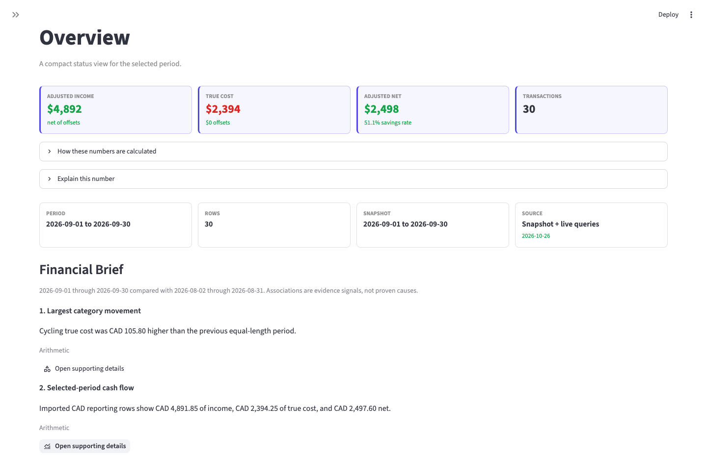
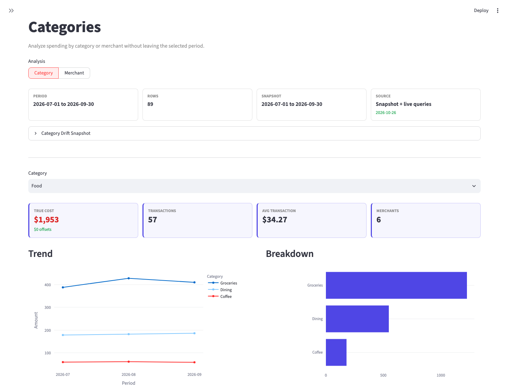
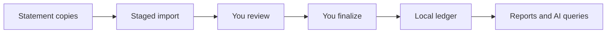

# Ledger

[](https://github.com/li-shangru/Ledger/actions/workflows/ci.yml)

**Turn your statements into financial answers you can check.**

Ledger is an offline, single-user ledger for statements, spending, and plans.
Review imports before they change your records, explore a local dashboard, or
ask an MCP client questions grounded in imported evidence.

**Python 3.14 · SQLite · MCP · MIT**

Locked UI and development environment: **macOS 26 · Apple silicon**.

[Get started](#get-started) · [How it works](#how-it-works) ·
[Documentation](docs/README.md) · [Contributing](docs/contributing.md)

## Dashboard preview

Illustrative dashboard using fictional data.

**Overview:** see income, true cost, and net cash flow alongside the reporting
period and links to supporting details.



<details>
<summary>See category trends and spending breakdowns</summary>

**Categories:** compare monthly trends and drill into the categories behind a
spending total, here groceries, dining, and coffee.



</details>

## Why Ledger?

A spending total can hide transfers, missing statements, or mixed currencies.
Planning adds another distinction: recorded activity versus expectations.

Ledger keeps those distinctions visible:

- **Review before records change.** Imports are staged for reconciliation and
  category review. You explicitly finalize the reviewed run before publication.
- **Ask from exact evidence.** Decimal amounts, reporting periods, exclusions, and
  statement coverage accompany answers through the read-only MCP interface.
- **Keep plans separate from facts.** Compare schedules and budgets with imported
  activity. Proposed changes need local review and approval before application.
- **Keep your working ledger local.** SQLite holds the records; statements,
  backups, and import history stay in a private directory outside the source tree.

Map a transaction CSV with an explicit private format profile, or install and enable
a trusted local adapter for supported PDF and investment layouts. The public core
contains no institution-specific importers. [Import adapters](docs/agent/import-adapters.md)
explains the API, trust boundary, and fictional package template.

## How it works



1. Map a CSV or enable a reviewed adapter, then select private statement copies.
2. Stage an import for extraction, reconciliation checks, and category review.
   Staging does not publish to your ledger.
3. Review the evidence, then explicitly finalize. Ledger backs up the target,
   publishes atomically, and archives statements.
4. Explore reports or ask your assistant. Planning changes require separate
   approval of their exact reviewed revisions.

After an interruption, resume the existing run. Do not restage to bypass recovery.
The [import guide](docs/agent/imports-and-recovery.md) covers review, cancellation,
investments, and recovery.

## Get started

You need **Python 3.14**. PDF imports also need Poppler's **`pdftotext`** on `PATH`;
install Poppler through your operating system's package manager.

Clone this repository and install the core CLI and MCP servers:

```sh
git clone https://github.com/li-shangru/Ledger.git
cd Ledger
python3.14 -m venv .venv
source .venv/bin/activate
python -m pip install .
ledger version
```

A reviewed release ZIP or sdist containing `SOURCE_MANIFEST.json` also works;
extract it and start at the virtual-environment step. GitHub's automatic
**Download ZIP** lacks that manifest and cannot build.

The core install includes the CLI and MCP servers. The verified dashboard and
development setup targets **macOS 26 on Apple silicon**. Follow
[Development](docs/agent/development.md) for optional dependencies and platform limits.

Choose a new private runtime outside every source repository and initialize it:

```sh
export LEDGER_HOME="$HOME/.local/share/ledger"
umask 077
mkdir -p "$LEDGER_HOME/inbox"
ledger config import --db "$LEDGER_HOME/ledger.db"
ledger db validate --db "$LEDGER_HOME/ledger.db"
```

This initializes a missing database with bundled synthetic configuration seeds.
Replacing existing configuration is guarded: it defaults to a dry run and requires
review before `--execute`. Keep the same `LEDGER_HOME` for subsequent operations.
Follow the [first-import walkthrough](docs/getting-started.md) before adding statements.

For the dashboard, complete the optional verified UI setup before running
`./scripts/run-app`. Its server binds to loopback; core installation alone is
insufficient.

Connect a client through local stdio, replacing both placeholders with exact
absolute paths:

```json
{
  "command": "/absolute/path/to/Ledger/.venv/bin/ledger-mcp",
  "args": ["--db", "/absolute/private-ledger/ledger.db"]
}
```

See [client setup](docs/agent/mcp.md). After importing, try:

> Summarize my imported spending for the latest complete calendar month.
> Show the date range, currency, exclusions, and coverage gaps.

## Know before you import

- **Evidence has limits.** Results cover imported statements only, with no live
  prices or FX conversions. Currencies stay separate. Ledger never treats
  missing evidence as zero.
- **Protect your private files.** Ledger's SQLite database is unencrypted. Protect
  the device and backups, and keep runtime files outside Git and shared folders.
- **Your client has its own privacy boundary.** A connected AI client may send tool
  results to its provider. Choose clients and their settings deliberately.
- **Reads cannot apply changes.** The read server cannot write. The separate
  proposal writer files intent; filing never applies a financial change.
- **Imports retain recovery state.** Finalize archives statements and keeps
  manifests. Preserve backups and follow the recovery procedure after failures.

See [security and privacy](docs/security.md) and
[runtime operations](docs/agent/local-operations.md). Ledger is an independent
project, unaffiliated with the financial institutions whose formats it reads.

## Explore and contribute

| I want to… | Start here |
| --- | --- |
| Import and review my first statements | [Walkthrough](docs/getting-started.md) |
| Use the dashboard and manage private files | [Local operations](docs/agent/local-operations.md) |
| Connect an assistant | [Client setup](docs/agent/mcp.md) |
| Change categories or review plans | [Configuration](docs/agent/configuration.md) · [Planning](docs/agent/planning.md) |
| Understand the design | [Architecture](docs/agent/architecture.md) |
| Map CSVs or create a private statement importer | [Import adapters and template](docs/agent/import-adapters.md) |
| Run tests or contribute a fix | [Contributing](docs/contributing.md) · [Agent guide](AGENTS.md) |

Report bugs with synthetic reproductions, never statements, databases, account
identifiers, or private logs. Contributor checks are source-only; installing into
configured maintainer clients is a separate [delivery workflow](docs/agent/delivery.md).

<details>
<summary>Version and dependency details</summary>

Version 1.11.2. Runtime: Python 3.14 and MCP Python SDK 2.2. Optional UI: Streamlit
1.66.1. Development: Playwright 1.62.0+ledger.1, locked to macOS 26 arm64. The
repository includes synthetic fixtures, public seeds, and dependency build recipes;
financial databases and private development history are excluded.

</details>

## License

Created and maintained by [Shangru Li](https://github.com/li-shangru).

Ledger's original code and documentation are available under the [MIT license](LICENSE).
Third-party components retain their own licenses and notices; see
[third-party notices](docs/third-party-notices.md).
